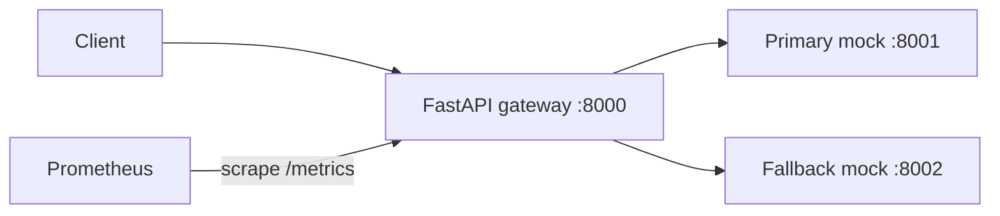

# InferenceGuard

A Python/FastAPI starter for an inference gateway that routes requests to a
compatible fallback when a backend fails or times out.

The current workload is **two mock services**, each doubling a list of numbers.
This exercises reliability without a GPU. Triton, real models, latency-aware
routing, Kubernetes deployment, and a benchmark CLI are future work.



## Run locally

Install [uv](https://docs.astral.sh/uv/getting-started/installation/), then:

```sh
uv sync --frozen
cp .env.example .env
```

Run these in three separate terminals from the repository root:

```sh
uv run uvicorn inference_guard.mock_backend:app --port 8001
uv run uvicorn inference_guard.mock_backend:app --port 8002
uv run uvicorn inference_guard.gateway:app --port 8000
```

Or start the services with Docker Compose:

```sh
docker compose up --build
# Optional Prometheus at http://localhost:9090:
docker compose --profile observability up --build
```

Interactive API docs: <http://localhost:8000/docs>.

## Try failover and recovery

```sh
curl -s http://localhost:8000/v1/infer \
  -H 'Content-Type: application/json' \
  -d '{"model":"double","inputs":[1,2,3]}'
# {"model":"double","outputs":[2.0,4.0,6.0],"backend":"primary"}

curl -s -X PUT http://localhost:8001/faults \
  -H 'Content-Type: application/json' -d '{"unavailable":true}'

# Repeat the inference request: it now succeeds through the fallback.
# After three failed primary attempts, the primary circuit opens.
curl -s http://localhost:8000/status
curl -s http://localhost:8000/metrics

# Reset faults. After the 10-second cooldown, the next request probes primary.
curl -s -X PUT http://localhost:8001/faults \
  -H 'Content-Type: application/json' -d '{}'

# To simulate a slow backend instead:
curl -s -X PUT http://localhost:8001/faults \
  -H 'Content-Type: application/json' -d '{"delay_seconds":2}'
```

`PUT /faults` replaces all fault settings; `{}` resets them. Fault injection is
an unauthenticated local demo feature. Compose publishes ports on loopback only.

## API and configuration

| Endpoint | Purpose |
| --- | --- |
| `POST /v1/infer` | Validate inputs and try primary, then fallback; 503 if both fail |
| `GET /healthz` | Gateway process liveness; does not probe backends |
| `GET /status` | Observed circuit states; does not actively check backend health |
| `GET /metrics` | Prometheus request totals, backend attempt totals and latency |
| Mock `POST /infer` | Deterministic `double` workload |
| Mock `PUT /faults` | Replace injected delay/failure settings |

Gateway settings load from the environment or `.env`. Compose explicitly sets
its own values in `compose.yaml`.

| Variable | Default |
| --- | --- |
| `IG_PRIMARY_URL` | `http://127.0.0.1:8001` |
| `IG_FALLBACK_URL` | `http://127.0.0.1:8002` |
| `IG_REQUEST_TIMEOUT_SECONDS` | `1` per backend attempt |
| `IG_FAILURE_THRESHOLD` | `3` consecutive failures |
| `IG_RECOVERY_TIMEOUT_SECONDS` | `10` |

## Layout

```text
src/inference_guard/
  gateway.py          FastAPI routes and shared HTTP client lifecycle
  backends.py         Ordered backend routing and response validation
  circuit_breaker.py  Closed/open/half-open state machine
  config.py           Validated environment settings
  metrics.py          Per-app Prometheus registry
  schemas.py          Shared inference request/response contract
  mock_backend.py     Deterministic workload and fault injection
tests/                Routing, deadlines, recovery, validation and mock tests
deploy/prometheus/    Optional scrape configuration
docs/architecture.md  Design boundaries and next implementation steps
```

## Development

```sh
uv run pytest
uv run ruff check .
uv run ruff format --check .
```

CI runs these checks and builds the Compose services. Dependencies are locked in
`uv.lock`. See [architecture notes](docs/architecture.md) for reliability semantics
and the path to a real inference workload.

MIT licensed.
