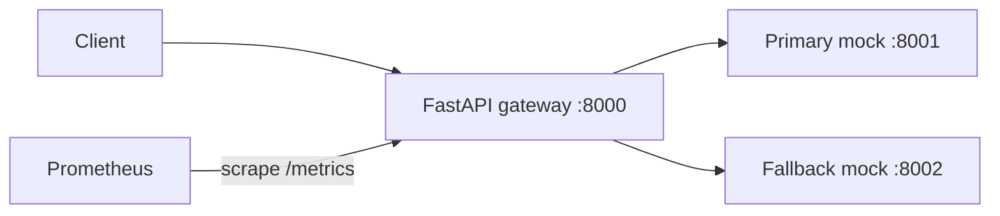

# InferenceGuard

A Python/FastAPI starter for an inference gateway that routes requests to a
compatible fallback when a backend fails or times out.

The default workload is **two mock services**, each doubling a list of numbers.
An alternative stack runs **NVIDIA Triton with an ONNX model on CPU** as primary,
preserving the same inputs and outputs through the mock fallback. Follow the
[Triton walkthrough](docs/triton.md) to run it and verify outage recovery.
The benchmark CLI measures baseline, outage, slow-backend, and recovery scenarios.
A [local Kubernetes deployment](docs/kubernetes.md) runs the gateway, Triton, and
fallback with resource budgets and health probes. Trained AI models and
latency-aware routing remain future work.



## Run locally

Install [uv](https://docs.astral.sh/uv/getting-started/installation/), then:

```sh
uv sync --frozen
cp .env.example .env
```

Run these in three separate terminals from the repository root:

```sh
uv run uvicorn inference_guard.mock_backend:app --port 8001
uv run uvicorn inference_guard.mock_backend:app --port 8002
uv run uvicorn inference_guard.gateway:app --port 8000
```

Or start the services with Docker Compose (requires a running Docker engine and
Compose v2). Local development and the container both use Python 3.14:

```sh
docker compose up --build
# Optional Prometheus at http://localhost:9090:
docker compose --profile observability up --build
```

Interactive API docs: <http://localhost:8000/docs>.

### Verify the container stack

Stop any local services using ports 8000–8002 first. Against a fresh demo stack:

```sh
docker compose config --quiet
docker compose up --build --wait --wait-timeout 120
docker compose exec -T gateway /app/.venv/bin/python --version
uv run python scripts/smoke_compose.py
docker compose down
```

The smoke check injects faults into both mocks and verifies primary inference,
fallback, circuit opening, recovery, timeout handling, all-down 503 responses,
and the metrics endpoint. It takes about 12 seconds and resets mock faults on
exit. Run it against a disposable stack with the default configuration; circuit
state may take another cooldown to recover afterward. If a check fails, inspect
`docker compose logs --no-color` before stopping the stack.

To keep local Python services running alongside Docker, select different host ports:

```sh
IG_GATEWAY_PORT=18000 IG_PRIMARY_PORT=18001 IG_FALLBACK_PORT=18002 \
  docker compose up --build --wait --wait-timeout 120
uv run python scripts/smoke_compose.py \
  --gateway-url http://127.0.0.1:18000 \
  --primary-url http://127.0.0.1:18001 \
  --fallback-url http://127.0.0.1:18002
```

## Try failover and recovery

```sh
curl -s http://localhost:8000/v1/infer \
  -H 'Content-Type: application/json' \
  -d '{"model":"double","inputs":[1,2,3]}'
# {"model":"double","outputs":[2.0,4.0,6.0],"backend":"primary"}

curl -s -X PUT http://localhost:8001/faults \
  -H 'Content-Type: application/json' -d '{"unavailable":true}'

# Repeat the inference request: it now succeeds through the fallback.
# After three failed primary attempts, the primary circuit opens.
curl -s http://localhost:8000/status
curl -s http://localhost:8000/metrics

# Reset faults. After the 10-second cooldown, the next request probes primary.
curl -s -X PUT http://localhost:8001/faults \
  -H 'Content-Type: application/json' -d '{}'

# To simulate a slow backend instead:
curl -s -X PUT http://localhost:8001/faults \
  -H 'Content-Type: application/json' -d '{"delay_seconds":2}'
```

`PUT /faults` replaces all fault settings; `{}` resets them. Fault injection is
an unauthenticated local demo feature. Compose publishes ports on loopback only.

## Benchmark failover and recovery

Start the mock stack with the Toxiproxy overlay, which lets the CLI interrupt or
delay traffic to the primary:

```sh
docker compose -f compose.yaml -f compose.benchmark.yaml \
  up --build -d --wait --wait-timeout 120
uv run --frozen inferenceguard benchmark \
  --scenario all --requests 100 --concurrency 10 \
  --output reports/benchmark.json
```

For Triton, replace `compose.yaml` with `compose.triton.yaml` in the Compose
command and allow `--wait-timeout 180`. Run one benchmark at a time against a
local demo stack with healthy backends. The CLI restores the faults it injects
on normal exit and interruption.

| Scenario | Passing behavior |
| --- | --- |
| `baseline` | Every measured request succeeds through primary |
| `outage` | Primary connections are disabled; every measured request succeeds through fallback |
| `slow-backend` | Primary responses are delayed past the gateway timeout; every measured request succeeds through fallback |
| `recovery` | After an outage opens the circuit, clear the fault; all measured requests succeed and primary returns before the recovery deadline |

`--requests` is the measured count **per scenario**. The table reports primary
and fallback counts, attempted requests per second, and p50/p95/p99 latency.
Latency includes failed requests; warmup and extra recovery probes are excluded
from those measurements. Recovery time is measured from fault removal and is
normally about 10 seconds with the Compose defaults. A full four-scenario run
also waits for primary recovery between phases.

The CLI reads `.env` in the current directory. It uses `IG_GATEWAY_PORT` (default
`8000`) and `IG_TOXIPROXY_PORT` (default `18474`) for local URLs. Override these
with `--gateway-url` and `--toxiproxy-url`, or set `IG_BENCHMARK_GATEWAY_URL` and
`IG_BENCHMARK_TOXIPROXY_URL`. Explicit CLI URLs take precedence.

```sh
# A quick run matching CI's workload: 80 measured requests in total.
uv run --frozen inferenceguard benchmark \
  --scenario all --requests 20 --concurrency 4 --warmup 4 \
  --output reports/benchmark-ci.json
uv run inferenceguard benchmark --help

# Use compose.triton.yaml here if you started the Triton stack.
docker compose -f compose.yaml -f compose.benchmark.yaml down
```

Exit codes are `0` for passing scenarios, `1` for failed expectations, and `2`
when the run cannot complete. Completed runs write the JSON report even when
expectations fail. The report includes configuration, individual samples,
errors, and recovery probes. Local `reports/` files are ignored by Git.

CI runs the small four-scenario workload against fresh mock services and the
fault proxy. It checks correctness and recovery without imposing throughput or
latency thresholds on shared runners. Download `benchmark-report` from the
workflow run's **Artifacts** section; reports are retained for 14 days, including
completed runs with failed expectations. Setup errors that prevent report
creation are recorded in the job logs.

## API and configuration

| Endpoint | Purpose |
| --- | --- |
| `POST /v1/infer` | Validate inputs and try primary, then fallback; 503 if both fail |
| `GET /healthz` | Gateway process liveness; does not probe backends |
| `GET /readyz` | Gateway lifespan readiness; stays ready during backend outages |
| `GET /status` | Observed circuit states; does not actively check backend health |
| `GET /metrics` | Prometheus request totals, backend attempt totals and latency |
| Mock `POST /infer` | Deterministic `double` workload |
| Mock `PUT /faults` | Replace injected delay/failure settings |

Gateway settings load from the environment or `.env`. Compose explicitly sets
its own values in `compose.yaml`.

| Variable | Default |
| --- | --- |
| `IG_PRIMARY_URL` | `http://127.0.0.1:8001` |
| `IG_FALLBACK_URL` | `http://127.0.0.1:8002` |
| `IG_PRIMARY_PROTOCOL` | `mock` (`triton` in `compose.triton.yaml`) |
| `IG_REQUEST_TIMEOUT_SECONDS` | `1` per backend attempt |
| `IG_FAILURE_THRESHOLD` | `3` consecutive failures |
| `IG_RECOVERY_TIMEOUT_SECONDS` | `10` |

## Layout

```text
src/inference_guard/
  gateway.py          FastAPI routes and shared HTTP client lifecycle
  backends.py         Ordered backend routing and response validation
  adapters.py         Mock and Triton HTTP protocol translation
  circuit_breaker.py  Closed/open/half-open state machine
  config.py           Validated environment settings
  metrics.py          Per-app Prometheus registry
  schemas.py          Shared inference request/response contract
  mock_backend.py     Deterministic workload and fault injection
  cli.py              Typer benchmark command and result table
  benchmark.py        Concurrent measurements and scenario checks
  faults.py           Toxiproxy fault injection and cleanup
tests/                Routing, deadlines, recovery, validation and mock tests
deploy/prometheus/    Optional scrape configuration
deploy/kubernetes/    Local kind cluster and Kubernetes workloads
docs/kubernetes.md    Deployment, failover verification, and cleanup
docs/architecture.md  Design boundaries and next implementation steps
```

## Development

```sh
uv run pytest
uv run ruff check .
uv run ruff format --check .
```

CI runs these checks plus type checking, builds and starts the Compose services,
and runs the smoke check. A separate benchmark job runs all four scenarios and
uploads its JSON report. Both jobs clean up their containers. Dependencies are locked in
`uv.lock`. See [architecture notes](docs/architecture.md) for reliability semantics
and the path to a real inference workload.

MIT licensed.
