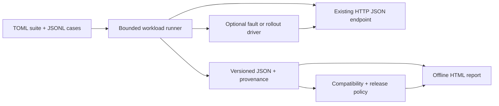
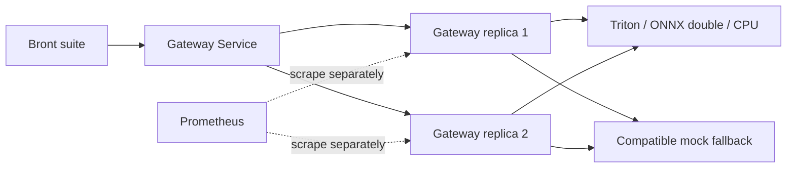

# Architecture

Bront is an experiment runner, not an inference gateway. Its core has no dependency
on FastAPI, Prometheus, a particular model server, or the optional reference stack.

## Core package

- `suites`, `validation`, and `targets` load explicit workload and response contracts.
- `measurement` and `runs` execute bounded, closed-loop traffic with whole-request
  deadlines and no retries. Warmup remains separate from measured traffic.
- `scenarios`, `proxy_scenarios`, and `kubernetes_scenarios` coordinate control
  events with measured traffic and preserve cleanup evidence on interruption.
- `results`, `provenance`, and `series` retain typed reports, fingerprints, and
  repeated-run manifests. Caller-declared deployment context is not attestation.
- `evidence`, `checks`, and `comparisons` validate source consistency and evaluate
  release policies. Unsupported comparisons remain incompatible or inconclusive.
- `html_reports` renders offline views of recorded evidence. Rendering a report
  is separate from deciding whether a release passes.

The only public commands are `run`, `compare`, and `report`. They use the same
JSON artifacts locally and in CI. The former gateway-specific benchmark runner
and manual control commands have been removed; there is no duplicate experiment
engine to maintain.

## Reference fixtures

`bront.reference` contains the optional gateway and mock backend. Compose and
Kubernetes deploy these fixtures with an optional Triton primary and fault proxy.
They provide a target for generic suites and do not participate in core imports.

Each gateway process owns its HTTP pool, metrics, and circuit breakers. It tries
primary and then fallback, validating protocol compatibility. Whole-attempt
timeouts include pool wait and response reads. Consecutive failed completions
open a circuit; after cooldown, one incoming request probes it. Generation tickets
prevent stale in-flight results from overriding newer circuit state.

Recovery is traffic-driven. `/status` is one process's observation, not an active
backend health check. `/readyz` reflects initialization and draining, independently
of backend health, so open circuits do not prevent fallback traffic and recovery.
The Kubernetes preStop hook retires connections while endpoints are removed.

The adapters and ONNX `double` model are deliberately narrow reference contracts,
not general model-serving integrations. This local fixture has no authentication,
admission control, streaming API, or production deployment claim. See the
[Triton](triton.md), [Kubernetes](kubernetes.md), and
[observability](observability.md) guides for its configuration.
