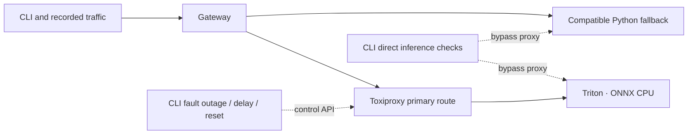

# Architecture and next steps

The [topology diagram](../README.md) shows the current Kubernetes deployment:
a Service selects either gateway pod, each with its own breakers and counters.
The Triton and fallback Services route to single backend pods. Prometheus discovers
gateway pod IPs directly; Grafana queries the provisioned Prometheus datasource.
The in-cluster benchmark uses the gateway Service so new connections can reach
either replica. HTTP keep-alive connections remain attached to a selected pod.

The Compose demo instead has one gateway and a Toxiproxy hop on its primary route:

[The recording](demo/README.md) demonstrates proxy failure, not a stopped Triton
process. The [Kubernetes experiment](experiments/rolling-updates.md) separately
scales Triton to zero while replacing both gateway pods under traffic.

## Current behavior

The gateway owns one pooled asynchronous HTTP client for its process lifetime,
using FastAPI's [lifespan API](https://fastapi.tiangolo.com/advanced/events/) and
[HTTPX async requests](https://www.python-httpx.org/async/).
Each validated inference request tries primary, then fallback. Backend HTTP
errors, transport errors, timeouts, invalid JSON, and incompatible response shapes
count as failures. A successful response resets that backend's failure count.
There is at most one attempt per backend per request.

Each backend has an independent circuit breaker. After the configured number of
consecutive failed completions it opens. After cooldown, one incoming request is
allowed to probe it; other concurrent requests skip it until the probe completes.
Success closes the circuit; failure starts a new cooldown. Recovery is driven by
traffic, so `/status` can still say `open` after cooldown until a request arrives.
Generation tickets keep older in-flight results from overriding a newer circuit.

The timeout bounds a full backend attempt, including pool wait and reading the
response. A request can spend approximately twice this timeout across two backends.
An upstream timeout cannot guarantee that the backend stopped computing. Failover
is appropriate here because the workload has no side effects.

Metrics report validated request outcomes, actual backend attempt outcomes, and
attempt latency including errors, one-hot circuit state, transitions, and completed
open-to-closed recovery episodes. Skipped circuits do not count as attempts.
The [Kubernetes monitoring stack](observability.md) scrapes each gateway pod
separately, preserving the independence of its counters and circuit observations.
Validation failures and disconnected/cancelled requests are not included in the
request outcome counter. `/healthz` is liveness only; neither it nor `/status`
guarantees that a backend will serve the next inference request.
`/readyz` tracks application lifespan readiness independently of backend health,
so open circuits do not stop the traffic needed for fallback and recovery.
In Kubernetes, a preStop hook creates a pod-local drain marker before shutdown.
The gateway then reports unready and sends `Connection: close` while completing
requests, allowing clients to reconnect through the Service before the process
exits. The hook waits ten seconds for endpoint changes and connection retirement.

## Deliberate starter boundaries

- Circuit state, mock faults, and metrics are in memory per worker. Run one worker
  per service for the demo. Replicas would have independent observations.
- Routing preserves primary preference; it does not rank backends by latency.
- The schema supports one numeric model (`double`), at most 1,024 finite inputs,
  and an equal number of finite outputs. The default stack uses mocks; the Triton
  stack executes an equivalent FP64 ONNX graph on CPU. Neither uses a trained model.
- This is a local development service without authentication, rate limits,
  admission control, streaming, or persistent state. The mock fault API belongs
  only in a development environment.
- The gateway trusts configured backends. Response byte limits and inbound body
  limits should be added before exposing it to untrusted traffic.

## Suggested implementation order

The mock and Triton adapters now share the existing circuit breaker and routing
logic. Triton model version `1` is pinned in both the adapter and model repository
configuration. See the [Triton walkthrough](triton.md) for the wire contract,
model generation, and a real container outage/recovery check.

The concurrent benchmark CLI reports success rate, fallback count, throughput,
latency percentiles, and recovery time. CI runs baseline, outage, slow-backend,
and recovery scenarios against mocks with Toxiproxy and uploads a JSON report.
See [benchmark instructions](../README.md#benchmark-failover-and-recovery).

The [local Kubernetes deployment](kubernetes.md) adds Deployments, Services,
configuration, resource budgets, and health probes, with two gateway replicas.
Each replica has independent circuit state and metrics.

The rolling-update verification replaces both gateway pods during sustained
in-cluster traffic, first with Triton healthy and then held unavailable. It
checks request outcomes, pod replacement, and rollout timing, then restores
Triton and checks primary recovery on each replica. See the
[verification walkthrough](kubernetes.md#verify-rolling-updates-under-traffic).

Next, add recent latency/error windows and evaluate whether latency-aware routing
improves measured behavior over primary-first routing.

TensorRT-LLM and NeMo remain optional future integrations. No production or
performance claims are implied by the starter.
