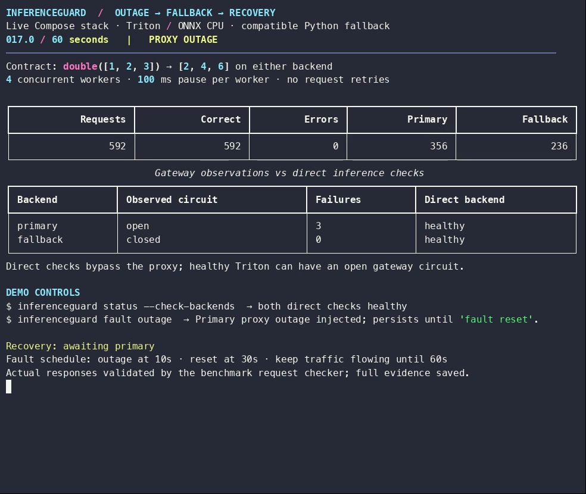

# A 60-second outage and recovery demonstration

[](inferenceguard.mp4)

Open [the MP4](inferenceguard.mp4) (download it if your repository viewer does not
play video). [The terminal recording](inferenceguard.cast) retains real event
timestamps; [the results](results.json) retain the command acknowledgements,
configuration, validated response counts, and observed recovery time.

This is an actual run against **Docker Compose**, with one gateway, real Triton
executing the FP64 `double` ONNX graph on CPU, a compatible Python fallback, and
Toxiproxy on the gateway's primary route. At ten seconds the CLI disables that
route; at thirty seconds it restores it. Four workers continue sending requests
throughout the sixty seconds. Each checks that either backend returns `[2,4,6]`.
Workers pause 100 ms between requests so the display is readable; this video is
not a capacity benchmark. Status polling uses a separate connection pool; measured
traffic retires idle connections after two seconds, before Uvicorn's default
five-second timeout, and never retries requests. The direct backend checks bypass Toxiproxy, so they
remain healthy even when the gateway's primary circuit opens. Direct checks run
at the start and after each fault command; circuit observations refresh once
per second. The health column retains the latest direct check, not a continuous
health guarantee.

The display is rendered from live responses and actual CLI subprocess output.
No request counts, transitions, or command outcomes are scripted. The scheduled
fault times are targets; the evidence records actual acknowledgement timestamps.
Recovery is measured from reset acknowledgement to the first successful primary
response for a request initiated afterward. Direct probes and warmup are excluded
from traffic counts. Playback is at original speed, without narration.


Published capture: **2,076/2,076 correct responses**, zero errors,
1,381 primary and 695 fallback. The first successful
post-reset primary response arrived **0.063 seconds** after
reset acknowledgement. This timing depends on when reset lands within the
request-driven circuit cooldown; it is not a general recovery bound.

## Reproduce

Start from the repository root. The defaults use ports 8000, 8001, 8002, and 18474:

```sh
docker compose -f compose.triton.yaml -f compose.benchmark.yaml up --build --wait
uv run python scripts/record_demo.py --output reports/demo.cast
```

For the alternate ports used by this recording:

```sh
IG_GATEWAY_PORT=18000 IG_PRIMARY_PORT=18001 IG_FALLBACK_PORT=18002 \
  docker compose -f compose.triton.yaml -f compose.benchmark.yaml up --build --wait
uv run python scripts/record_demo.py \
  --gateway-url http://localhost:18000 \
  --primary-url http://localhost:18001 \
  --fallback-url http://localhost:18002 \
  --toxiproxy-url http://localhost:18474 \
  --output reports/demo.cast
```

The script requires a clean proxy and successful primary warmup. It executes the
same CLI entry point as `inferenceguard status --check-backends`, `fault outage`,
and `fault reset`. A `finally` block resets its fault on exit. After a forced kill
that prevents cleanup, run `uv run inferenceguard fault reset` explicitly.
It saves the cast and a full JSON report (including individual requests) under
ignored `reports/`. Only this curated recording and its compact evidence are
committed; ordinary benchmark reports stay ignored.

Install [agg](https://github.com/asciinema/agg) and [FFmpeg](https://ffmpeg.org/)
(`brew install agg ffmpeg` on macOS), then render:

```sh
agg --theme dracula --font-size 16 --idle-time-limit 120 \
  --last-frame-duration 0.1 --no-loop reports/demo.cast reports/demo.gif
ffmpeg -y -i reports/demo.gif -vf 'pad=ceil(iw/2)*2:ceil(ih/2)*2' \
  -c:v libx264 -pix_fmt yuv420p -r 20 -movflags +faststart reports/demo.mp4
```

To explore the two-replica deployment, use the [Kubernetes dashboard](../observability.md).
The [curated Kubernetes experiment](../experiments/rolling-updates.md) separately
checks continuity during gateway replacement, with Triton healthy and then scaled
to zero. Its hardware and configuration are documented; it is not the video run.

## Recording checks and limitations

The first capture had one unclassified transport error out of 2,064 attempts,
25 seconds into the run. A second capture using the same request path had zero
errors in 2,072 attempts. The exact cause of the first failure was not established;
a keep-alive boundary race was a hypothesis, not a confirmed diagnosis.
Before the published capture, the recorder separated status polling from the
measured connection pool, shortened idle connection reuse to two seconds, and
added transport exception diagnostics. No gateway routing changes or retries
were introduced to obtain the final recording. [Capture history](capture-history.json)
preserves all three summaries and the original failed sample, so the final video
is not evidence that every run is error-free. The Kubernetes experiment is
independent of these Compose captures.
