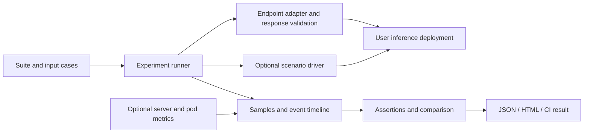

# Proposal: inference reliability and release validation

Status: milestones 1–2 implemented, remaining milestones proposed, 2026-10-12.
Working name: **Bront**. `bront run` and reusable scenarios are available.
Comparison and report rendering below remain proposed interfaces. See the
[external endpoint guide](../external-endpoints.md) for the implemented contract.
The repository and Python package retain their existing names; `bront` is an
additional CLI entry point alongside `inferenceguard`.

## Product

A developer runs a repeatable experiment against an inference deployment and
receives evidence that it meets—or violates—explicit correctness, latency,
availability, and recovery requirements.

Primary user: an ML platform engineer reviewing a serving image, deployment,
model, or configuration change. Initial setting: a local or staging deployment
and its CI workflow. The first successful adoption is someone testing an existing
service without installing our gateway or changing the service's response schema.

Suggested description: **Reliability tests for inference deployments.**

The focused InferScope direction becomes an experiment and release-validation
tool. Its main contribution is coordinating traffic, controlled failures,
rollouts, assertions, and evidence. Benchmarking and observability support that
workflow. Demand remains a hypothesis to validate with external users.

## Existing foundation and the original blocker

The repository already has bounded asynchronous traffic generation, timeouts,
response validation, four benchmark scenarios, fault restoration, Kubernetes
rollout verification, per-pod observability, CI artifacts, and measured examples.

The reference demo in `src/inference_guard/benchmark.py` assumes all of the following:

- POST `/v1/infer` with the fixed `double([1,2,3])` payload.
- An `InferenceResponse` containing `backend: primary|fallback`.
- A gateway `/status` endpoint with circuit state and timeout configuration.
- A healthy baseline always returning `primary`.
- A particular Toxiproxy proxy name and demo topology for fault scenarios.

The demo baseline depends on gateway status. Milestone 1 adds an independent
request/validation engine and shares bounded scheduling and percentile calculation
with the existing benchmark. Gateway-specific setup remains in the demo.

## Proposed user workflow

1. Describe the endpoint, representative inputs, expected responses, and workload.
2. Run a baseline against the current deployment.
3. Run the same suite against a candidate deployment, optionally with an explicit
   fault or rollout scenario.
4. Review assertions and a comparison report. CI returns a failing exit code when
   the declared requirements fail, with evidence available even after a failed run.

Proposed commands, introduced incrementally:

```sh
bront run suite.toml --output reports/baseline.json
bront run suite.toml --url http://candidate:8000/predict --output reports/candidate.json
bront compare reports/baseline.json reports/candidate.json --policy limits.toml
bront report reports/candidate.json --baseline reports/baseline.json --output reports/review.html
```

The first command is useful independently. Comparison and HTML reporting follow
later. Kubernetes, Prometheus, Triton, and the reference gateway are optional
unless a selected adapter or scenario requires them.

## Milestone 1: test an external HTTP endpoint

Implemented as the first feature commit. The acceptance fixture also runs in CI.

### Deliverables

- Typed target, workload, input-case, validation-result, and run-report models.
- An HTTP JSON adapter with configurable URL, method, headers, request bodies,
  and expected status. Header values can reference environment variables.
- JSONL input cases, visited in deterministic order and repeated as needed.
  Resolve case paths relative to the suite file, not the invoking directory.
- Response assertions using JSON Pointer paths: required values, exact equality,
  and numeric absolute/relative tolerance with matching array shape. Missing
  paths, non-finite values, invalid JSON, and incompatible shapes fail validation.
- Optional backend identity extraction from an explicitly configured field or
  header. Unknown identity is recorded as unknown. Success does not require it.
- A baseline runner with bounded concurrency, duration or request-count modes,
  warmup, whole-request timeouts, and explicit assertions. No request retries by
  default. Record detailed transport error types instead of only one generic label.
- Separate HTTP status, transport, timeout, and output-validation failures.
  Warmup/preflight results are retained separately from measured traffic.
- A versioned report independent of `GatewayConfiguration`. The new schema is
  distinct from existing benchmark schema v2; existing reports remain readable
  by their existing tools rather than being silently reinterpreted.
- A contract adapter retaining the existing gateway demonstration and checks.
- A standalone example server with a different path and JSON schema, no `/status`
  or `/readyz`, and no backend field. This proves independence from our gateway.

Use TOML for suites: it is familiar alongside `pyproject.toml` and Python already
includes `tomllib`. Keep workload cases in JSONL so payloads do not overwhelm
configuration. Illustrative baseline suite:

```toml
version = 1

[target]
adapter = "http-json"
url = "http://127.0.0.1:9000/predict"
method = "POST"

[workload]
cases = "cases.jsonl"
concurrency = 8
duration_seconds = 30
warmup_requests = 8
request_timeout_seconds = 5

[assertions]
max_failed_requests = 0
max_p95_ms = 200
```

Illustrative `cases.jsonl` record (one JSON object per line):

```json
{"name":"known-input","body":{"features":[1,2,3]},"expect":{"status":200,"json":[{"pointer":"/prediction","equals":[2,4,6],"abs_tol":1e-9,"rel_tol":1e-9}]}}
```

The fixture is intentionally small. These assertions verify a supplied contract,
not model quality in general. A trained-model example follows in milestone 5.

### Acceptance checks

1. A clean installation measures the standalone `/predict` example without any
   gateway, mock backend, Triton, Toxiproxy, Prometheus, or Kubernetes dependency.
2. A valid response passes; wrong output, missing fields, malformed JSON, 503,
   timeout, and connection failure are classified correctly and fail the suite.
3. Expected inputs and outputs vary across cases. Tolerance checks reject wrong
   shapes and do not accidentally treat booleans as numbers.
4. No hidden `/status`, `/readyz`, primary warmup, or fallback assumptions remain
   in generic baseline runs. Optional backend identity does not affect success.
5. Config validation happens before traffic. Missing credential references fail
   clearly; credentials and raw payloads are excluded from normal report output.
6. The existing four-scenario demo, CLI, schema-v2 reports, and CI remain supported
   during migration. Their gateway-specific setup stays in the demo integration.
7. A failed or interrupted run leaves a report describing completed work and
   its termination reason. Incomplete execution cannot produce a passing verdict.

## Milestone 2: reusable fault and rollout scenarios

Implemented with four drivers, bounded lifecycle events, restoration, and distinct
service/preferred-backend recovery checks. See the [scenario guide](../scenarios.md)
for examples, timing definitions, concurrency limitations, and report schema 2.

Move the existing Toxiproxy and Kubernetes orchestration into scenario drivers.
A driver declares capabilities and provides preflight, apply, observe, and restore
operations. It records intended event times, actual start/acknowledgement times,
and restoration outcomes on the same monotonic timeline as measured traffic.

Start with baseline, primary-path outage/recovery, response delay, and Kubernetes
Deployment rolling restart. Keep a distinct scenario for scaling a backend to
zero; a disabled proxy and a stopped inference process are different experiments.

Kubernetes configuration names the context, namespace, Deployment, and expected
replicas explicitly. Record original replica counts and object identity, scope
changes to the configured objects, detect unexpected concurrent changes, and
restore owned faults on normal exit or cancellation. A rolling restart is an
intentional rollout and is not presented as a reversible temporary fault.
Restoration failure or incomplete execution makes the run an execution error.

Assertions distinguish availability from routing. Returning a valid response
can prove service recovery. Returning to a preferred backend requires an identity
signal; without one that assertion is unsupported, not silently successful.
Circuit observations and active health checks remain distinct.

Acceptance: external endpoints can run a supported scenario without our gateway;
rollout tests prove replacement overlaps measured traffic; cleanup is exercised
under errors and cancellation; missing scenario capabilities fail before mutation.

## Milestone 3: release assertions and trustworthy comparison

Add explicit policies for failed requests, output correctness, latency budgets,
recovery deadlines, and relative regressions. Define latency populations and
recovery clock boundaries in reports. For the initial runner, request latency
includes all measured attempts; error counts are always shown alongside it.
An incomplete workload never passes solely because completed requests were fast.

Fingerprint the adapter, cases, assertions, load mode, concurrency/rate, warmup,
timeout, and measurement duration. Record model and serving revision identities,
resource configuration, architecture, and caller-supplied environment labels.
Distinguish the intended experimental variable (such as model or serving revision)
from accidental changes to the workload or environment. Endpoint host differences
are allowed for baseline/candidate deployments. Material unaccounted differences
make a comparison incompatible; missing metadata is visible.

Use repeated runs for performance regression claims and report variation. A single
small percentile shift is descriptive evidence, not proof of a regression.
A minimum evidence policy can return inconclusive rather than a false pass.
On shared CI runners, gate deterministic correctness and broad bounds initially;
reserve tight performance gates for a controlled measurement environment.

Exit codes: 0 for completed passing assertions, 1 for completed failing assertions,
2 for invalid configuration, execution/cleanup errors, or an inconclusive comparison.
Preserve the conventional interrupt status for cancellation and write its report.

## Milestone 4: reports people can review

Generate a self-contained HTML report and JSON evidence, with an optional JUnit
summary for CI. Show the experiment configuration, event timeline, correctness
failures, per-window availability/latency, recovery definition, and baseline
comparison. Escape untrusted report text and omit credential values.

Keep structured samples in bounded buffers or stream them to an artifact rather
than retaining an unbounded list for long runs. Document aggregation precision.
Raw requests/responses are opt-in; store case identifiers and validation reasons
by default. CI uploads evidence on failure as well as success.

The report should let a reviewer connect an observed failure with a rollout or
fault event without claiming causation that the experiment cannot establish.
Prometheus evidence is optional and preserves per-pod identity. The existing
Grafana dashboard remains useful for live investigation.

## Milestone 5: a credible inference example and external validation

Add a small trained CPU model served by Triton, with reproducible model version,
preprocessing, inputs, and output checks. Keep `double` for rapid smoke tests.
Reuse the wire-format work in `adapters.py`, while removing its hardcoded model,
tensor names, datatype, and shape assumptions where the supported contract needs it.
If the example includes fallback, use a documented equivalent model/runtime and
explicit tolerances; a different trained model is not automatically equivalent.

Publish one experiment against that workload and have two external users try
suites against services they already maintain. Acceptance is independent adoption:
they get a useful failure or release decision without editing the tool's source
or adopting our gateway. Their friction determines the next feature priority.

## Internal architecture and migration



Introduce small internal modules for suites, targets, validation, results, and
scenarios under the current package. Reuse the worker loop and measurement logic;
keep the old benchmark facade working while migrating scenario code behind it.
`controls.py` currently imports `GatewayConfiguration` from `benchmark.py`; move
shared gateway-specific types out before splitting the runner to avoid coupling
status commands to the generic engine.

Keep the gateway and its Docker/Kubernetes assets as a reference application.
Do not move every file or rename every metric in the first functional change.
Once the generic runner is useful and the name is selected, make a separate
rename commit for distribution metadata, CLI aliases, imports, docs, and CI.
Repository hosting changes are a distinct final naming step.

Prefer integrating established tools for future specialized load generation.
NVIDIA [Perf Analyzer](https://github.com/triton-inference-server/perf_analyzer),
[Model Analyzer](https://github.com/triton-inference-server/model_analyzer), and
[AIPerf](https://github.com/ai-dynamo/aiperf) already cover substantial inference
benchmarking and tuning. Our proposed focus is coordinating reliability scenarios
and explaining release assertions with evidence; uniqueness and demand are not
established merely by that positioning.

Defer a hosted service, custom Kubernetes operator, adaptive routing, LLM-based
root-cause diagnosis, and streaming/LLM metrics until the initial workflow earns
usage. The first runner is explicitly closed-loop concurrency traffic: its arrival
rate drops when requests slow down. Do not claim fixed-rate overload resilience
from those results. Add rate-controlled traffic or integrate a suitable engine
when that experiment becomes necessary.

## Naming proposal

**Bront** is the preferred working name: five letters, pronounced “bront,” with
a thunder/stress association. It is short in commands and leaves room for a
broader testing product without embedding a vendor or deployment platform.

**Brunt** is the strongest semantic alternative: a system bears the brunt of a
failure or load spike. The exact PyPI name already belongs to an unrelated device
SDK, so a distribution suffix would be required unless that situation changes.

**InferenceGuard** remains a reasonable descriptive fallback and preserves the
current identity. Its current presentation strongly suggests an inline gateway;
a new description and quickstart would need to make external testing prominent.

Initial screening on 2026-10-12 found an existing
[Bront programming-font project](https://github.com/chrismwendt/bront) and the
[Brunt device SDK](https://pypi.org/project/brunt/). The PyPI JSON endpoint for
`bront` returned 404 at the time of checking. That is a point-in-time observation,
not a reservation or evidence of exclusive use. Domain and organization names
have not been selected. The CLI alias is available; repository and distribution renaming remains a separate step.

Several attractive alternatives have closer developer-tool overlap:
[Cairn browser testing](https://github.com/team-poem/cairn),
[Fettle repository checks](https://github.com/marketplace/actions/fettle-repository-health-grade),
[Strake deploy safety](https://strake.dev/), and
[Terva's agent CLI](https://github.com/terva-sh/terva).

## Delivery order

1. External-target models, HTTP JSON adapter, validation, and standalone acceptance
   fixture; preserve the existing demo entry points.
2. Scenario drivers and recorded fault/rollout lifecycle, including restoration.
3. Assertions, comparison compatibility, repeated-run evidence, and CI verdicts.
4. Shareable reports and artifact handling.
5. Trained Triton workload, reproducible example, and external user trials.
6. Separate naming migration once the chosen name and runnable experience align.

Each numbered implementation milestone should have its own reviewable commit,
with further splits if needed to keep changes understandable. The first release
must include external endpoint support, at least one useful failure scenario,
explicit assertions, and a shareable result. A baseline-only first milestone is
an implementation foundation, not the complete differentiated product.
