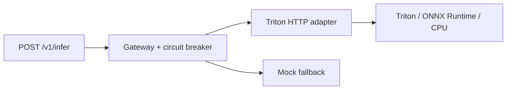

# Run Triton as the primary backend

The public API stays the same: send a `double` request with a list of numbers,
receive a list of doubled numbers plus `backend: primary` or `backend: fallback`.
The primary now executes a real ONNX graph in NVIDIA Triton; the fallback still
performs the same arithmetic in Python. This is an integration workload, not a
trained AI model or an inference performance benchmark.

## 1. Understand the path



The adapter calls `/v2/models/double/versions/1/infer` with a one-dimensional FP64
tensor named `INPUT`, requesting `OUTPUT`. It verifies the returned model, version,
tensor name, datatype, dimensions, data length, and finite numeric values.
An incompatible response counts as a backend failure and triggers fallback.

Tensor values use Triton's binary tensor extension (little-endian FP64); metadata
and the public API remain JSON. This avoids an additional decimal conversion
inside Triton: its JSON tensor path rounded a tested near-limit value into an
overflowing result. Binary transport preserves that value and subnormal values.

Both implementations use 64-bit floats to preserve the existing Python numeric
contract. The ONNX model multiplies by `2.0`, accepts a variable-length vector,
and disables batching (`max_batch_size: 0`). The gateway still limits requests
to 1–1,024 finite inputs. Values whose doubled result overflows cannot produce a
valid response from either backend, as with the original mock setup.

## 2. Start the stack

Docker Desktop must be running. The published Triton image is a multi-gigabyte
download with Linux ARM64 and AMD64 variants. On an Apple Silicon Mac, Docker
uses its Linux ARM64 virtual machine. This configuration requests CPU execution
with `KIND_CPU`; an NVIDIA GPU is not required. The gateway container uses Python
3.14; Triton uses its own NVIDIA-supplied runtime.

From the repository root:

```sh
uv sync --frozen
docker compose -f compose.triton.yaml config --quiet
docker compose -f compose.triton.yaml up --build --wait --wait-timeout 180
docker compose -f compose.triton.yaml ps
```

This replaces the primary mock in the existing Compose project. Use the same
Compose project name if you previously supplied `--project-name`.

The file inherits your `IG_GATEWAY_PORT`, `IG_PRIMARY_PORT`, and `IG_FALLBACK_PORT`
settings from `.env`. The examples below assume **18000, 18001, and 18002**,
matching the earlier Docker walkthrough. Without those settings, the defaults
are **8000, 8001, and 8002**.

You do not need to change backend URLs in `.env`. Compose configures the gateway
with `IG_PRIMARY_URL=http://primary:8000` and `IG_PRIMARY_PROTOCOL=triton`.

The 140-byte ONNX model is committed under
`deploy/triton/models/double/1/model.onnx`. To regenerate it:

```sh
uv run python scripts/build_triton_model.py
```

## 3. Verify the model and gateway

Triton's model readiness endpoint returns HTTP 200 with an empty body:

```sh
curl -i http://localhost:18001/v2/models/double/versions/1/ready
curl -s http://localhost:18001/v2/models/double/versions/1
curl -s http://localhost:18000/v1/infer \
  -H 'Content-Type: application/json' \
  -d '{"model":"double","inputs":[1,2,3]}'
```

Expected gateway response:

```json
{"model":"double","outputs":[2.0,4.0,6.0],"backend":"primary"}
```

`primary` is still the routing label; in this stack it refers to Triton.
The mock-only `scripts/smoke_compose.py` and primary `/faults` endpoint do not
apply to Triton. Use the dedicated integration check:

```sh
uv run python scripts/smoke_triton.py \
  --gateway-url http://127.0.0.1:18000 \
  --primary-url http://127.0.0.1:18001
```

This checks numeric parity, **stops the primary container**, verifies fallback
and circuit opening, then restarts Triton and verifies recovery. It restores the
primary in a `finally` block. Use it only on the local demo stack. It assumes the
default circuit settings and a healthy mock fallback. Pass `--project-name` if
you started a custom Compose project.

## 4. Try failover manually

```sh
docker compose -f compose.triton.yaml stop primary
# Repeat the gateway curl request: same outputs, backend is now fallback.
docker compose -f compose.triton.yaml start primary
# Wait for Triton readiness and the circuit's 10-second cooldown, then retry.
```

Recovery occurs on the next incoming request after cooldown; it is not a
background restart mechanism. The gateway routes around a stopped service,
and Docker's `start` command brings that service back.

For startup problems:

```sh
docker compose -f compose.triton.yaml logs --tail 100 primary
```

Check that `double` version `1` is `READY`. GPU-related startup warnings may
appear without an NVIDIA GPU; successful model readiness is the relevant check
for this CPU configuration. If the container is killed due to memory pressure,
increase Docker Desktop's memory allocation.

To stop this stack or switch back to mocks:

```sh
docker compose -f compose.triton.yaml down
docker compose up --build --wait
```

## Reference documentation

- [NVIDIA backend/platform support](https://docs.nvidia.com/deeplearning/triton-inference-server/user-guide/docs/backend/docs/backend_platform_support_matrix.html)
- [Triton model configuration](https://docs.nvidia.com/deeplearning/triton-inference-server/user-guide/docs/user_guide/model_configuration.html)
- [Inference HTTP protocol](https://github.com/kserve/open-inference-protocol/blob/main/specification/protocol/inference_rest.md)
- [Triton binary tensor extension](https://docs.nvidia.com/deeplearning/triton-inference-server/user-guide/docs/protocol/extension_binary_data.html)
